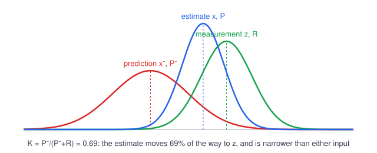
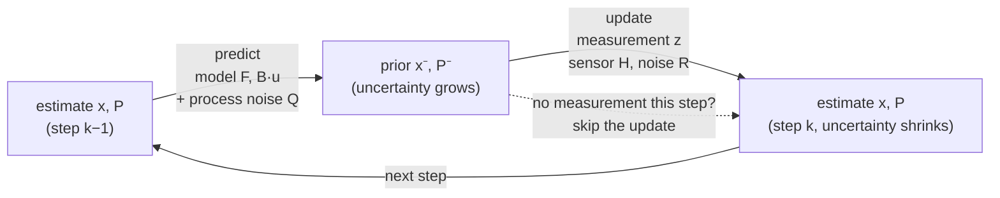
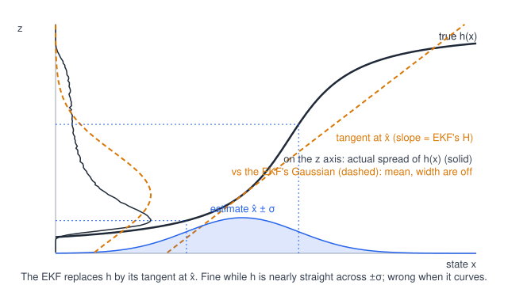

# Kalman filtering, by picture

How a Kalman filter works and how to tell whether yours is working. This is about the ideas, not this library's API; every
section points at a runnable demo that shows the idea. Run each demo from the repo root; it prints a summary and opens an
interactive plot (also saved in `examples/out/`). Add `--no-show` to skip opening the browser and `--seed N` for another run.

| § | Topic | Demo |
|---|---|---|
| 1 | The idea | [blend_1d.svg](img/blend_1d.svg) |
| 2 | Every matrix, one cycle at a time | `kf_anatomy.py`, `projectile_kf.py` |
| 3 | Linear vs extended KF | `drag_projectile_ekf.py`, `drag_lkf_vs_ekf.py` |
| 4 | How sensors shape the estimate | `drag_projectile_fusion.py`, `rocket_drag_estimation.py` |
| 5 | What goes wrong | `pitfalls.py`, `drag_lkf_vs_ekf.py` |
| 6 | Tuning Q and R | `tuning_sweep.py` |
| 7 | Metrics cheat sheet | all of the above |

---

## 1. The idea

You have two imperfect sources of information about something that moves:

- a **model**: "the ball was here going this fast, so 0.05 s later it is about *there*", which drifts because the model
  is never exact;
- a **sensor**: "the ball is here, give or take 2 m", which is noisy but doesn't drift.

The filter keeps a best guess **and how unsure it is**, as a Gaussian (mean + covariance). Each step it **predicts** with
the model (uncertainty grows), then **updates** with a measurement (uncertainty shrinks). The update is a weighted average,
weighted by how much it trusts each side:

In 1D: `x = x⁻ + K (z − x⁻)` with `K = P⁻ / (P⁻ + R)`. If the prediction is vague (big P⁻), K → 1 and you follow the sensor;
if the sensor is noisy (big R), K → 0 and you follow the model. The result is narrower than either input. Everything else
is this idea in more dimensions.

---

## 2. Every matrix, one cycle at a time

**Predict:**

$$x^- = F x + B u \qquad P^- = F P F^\top + Q$$

**Update:**

$$y = z - H x^- \qquad S = H P^- H^\top + R \qquad K = P^- H^\top S^{-1}$$
$$x = x^- + K y \qquad P = (I - K H)\, P^-$$

| Symbol | Name | What it means | In the projectile demos |
|---|---|---|---|
| x | state | everything you want to estimate, including things you never measure | `[x, y, vx, vy]` |
| P | state covariance | how unsure the filter is about x, and how the errors are **correlated** | starts with σ = 2 m in position, 5 m/s in velocity |
| F | state transition | how the state moves over one step if nothing disturbs it | position += velocity · dt |
| B, u | control input | known forces you feed in instead of estimating | gravity, u = −g |
| Q | process noise | how wrong the model can be per step: forces you don't model | random gusts |
| z | measurement | what the sensor reports | noisy `[x, y]` |
| H | measurement model | which combination of the state the sensor sees | `[I 0]`: position only |
| R | measurement noise | how noisy the sensor is | σ = 2 m per axis |
| y | innovation | surprise: measurement minus what the filter expected to see | |
| S | innovation covariance | how big the filter *expects* the surprise to be (model uncertainty + sensor noise) | |
| K | Kalman gain | how far to move toward the measurement, per state element | settles to a constant |

**Demo: `uv run python examples/kf_anatomy.py`** draws one cycle as 2σ ellipses for a ball thrown straight up, with an
altimeter that measures height only.

- **Panel 1 (predict):** the round grey ellipse (P) is **sheared** by F into a tilted one: if the velocity is off, the
  height will be off too, so the errors become correlated (+0.53 in the printout). Q then puffs it up.
- **Panel 2 (update):** the measurement is a vertical green strip, because H only constrains height. The posterior (blue)
  shrinks in height, **and also in velocity**: the correlation from predict lets a height reading correct the velocity.
  That's how a filter estimates things no sensor measures.
- **Panels 3-4:** σ follows a sawtooth (up in predict, down in update) and settles.
- **Panel 5:** K settles to a constant; for a linear filter with fixed F, H, Q, R, it doesn't depend on the data at all.
- **Panel 6:** innovations should stay inside ±2√S about 95% of the time. That's the filter's own self-check (§7).

Try `--step 6`: by then the correlation is +0.85 and the update moves vy almost as much as y.

**Demo: `uv run python examples/projectile_kf.py`** is the same filter in 2D. Position RMSE drops from 2.84 m (raw
measurements) to 1.13 m, and the velocity panel shows a quantity that is never measured converging to the truth, with its
±2σ band narrowing.

---

## 3. Linear vs extended Kalman filter

The equations above are exact only when the motion and the measurement are **linear**: `x_next = F x` and `z = H x`.
Real systems often aren't:

- **Motion:** air drag is `−k|v|v`, so the next state is a nonlinear function `f(x, u)`.
- **Measurement:** a radar reports range `√(dx² + dy²)` and bearing `atan2(dy, dx)`, a nonlinear function `h(x)`.

The **EKF** keeps the same loop but uses the nonlinear `f` and `h` to move the mean and compute the expected measurement.
For the covariance, it uses their **Jacobians** (local slopes) at the current estimate in place of F and H:

| | LKF | EKF |
|---|---|---|
| predict mean | `F x + B u` | `f(x, u)` |
| expected measurement | `H x⁻` | `h(x⁻)` |
| F, H in the covariance math | fixed matrices | Jacobians ∂f/∂x, ∂h/∂x, recomputed each step at the estimate |
| gain | settles to a constant | changes with the state (e.g. radar geometry) |
| optimal? | yes, for linear-Gaussian systems | an approximation; good when nonlinearity is mild over ±σ |

The tangent is a good stand-in only while the function is nearly straight across the filter's uncertainty. A target
passing close to a camera, or a huge initial uncertainty, breaks this, and the EKF becomes overconfident or diverges.
With linear f and h the EKF reduces to the LKF exactly.

**Demo: `uv run python examples/drag_projectile_ekf.py`.** Drag model + radar. The radar's polar measurements, converted
to x/y, have 2.62 m RMSE; the EKF gets 0.72 m. The printed vacuum range (255 m vs the true 110 m) shows how wrong a drag-free
model would be.

**Demo: `uv run python examples/drag_lkf_vs_ekf.py`.** Same drag flight, same linear GNSS sensor, three filters:

| filter | pos RMSE | ANEES (ideal 4) | what's happening |
|---|---|---|---|
| LKF, true Q | 5.31 m | 1161 | ignores drag and believes its model: confidently wrong |
| LKF, Q inflated (gust σ × 30) | 1.34 m | 3.9 (but in bounds only 23% of the time) | treats drag as "noise": usable, sloppy |
| EKF | 0.82 m | 4.05 (in bounds 97%) | models the physics |

Lesson: if the sensor is linear but the motion isn't, you still need an EKF, or you pay with a fudged Q (§6).

---

## 4. How sensors shape the estimate

A sensor contributes three things: **what** it sees (H), **how well** (R), and **when** (rate, field of view, outages).
The filter fuses them by stacking updates: each measurement that arrives this step gets its own update.

| sensor | measures | good at | blind spot |
|---|---|---|---|
| GNSS | position (linear) | absolute position, no drift | slow (2 Hz here), outages |
| radar | range + bearing | range | cross-range error grows with distance: σ ≈ range × σ_bearing |
| camera | one image coordinate: a **direction** only | fast, precise angles | no range at all; needs a second camera (stereo) or motion to triangulate |

Geometry matters as much as noise: two cameras looking from very different angles pin down position well; two cameras
side by side barely help in depth.

**Demo: `uv run python examples/drag_projectile_fusion.py`.** One flight, three filters on the same data:

- **GNSS only (2.71 m RMSE):** error jumps between fixes and grows during the 1 s outage (shaded), where the filter coasts
  on its model.
- **Stereo cameras only (1.48 m):** good while both see the target, poor at the edges of the fields of view, where only one
  camera sees it and range is unobservable.
- **Fused (0.92 m):** better than either. Cameras fill the gaps between GNSS fixes and carry the filter through the
  outage, and GNSS anchors range where the cameras can't.

The bottom strip shows exactly when each sensor reported; compare it to the error spikes.

**Demo: `uv run python examples/rocket_drag_estimation.py`.** Sensors can reveal things they never measure, as long as the
model connects them. Add the rocket's drag coefficient Cd to the state; radar and GNSS see only position, but drag bends
the trajectory, so the filter learns Cd (prior 0.45 ± 0.10 → 0.4036 ± 0.0019, truth 0.4047). Knowing Cd cuts position RMSE
from 4.29 m (Cd fixed at the wrong guess) to 0.93 m. This trick is called **state augmentation**. It works only if the
parameter actually affects what's measured, i.e. it is *observable*.

---

## 5. What goes wrong

**Demo: `uv run python examples/pitfalls.py`** runs one flight five ways with an otherwise perfect filter:

| scenario | pos RMSE | ANEES (4) | ANIS (2) | what you see |
|---|---|---|---|---|
| baseline | 1.19 m | 4.8 | 2.0 | errors inside ±2σ, NIS inside bounds |
| overconfident start (P0 too small, guess 8 m/s off) | 3.85 m | 244 | 5.8 | filter ignores measurements; errors far outside a tiny band; NIS high early |
| dropout (1.5 s no data) | 2.34 m | 6.1 | 2.1 | σ grows while coasting; error grows *within* it, then recovers. Healthy. |
| outliers (3 × +20 m) | 1.47 m | 9.1 | 5.0 | NIS spikes at exactly those steps: gate on NIS to reject them |
| sensor bias (+3 m on x) | 3.03 m | 59 | **2.0** | error sits outside ±2σ, but NIS looks perfect |

The bias row is the important one: **the innovations can't reveal an error the filter absorbs into its estimate.** A
biased sensor looks like a slightly different trajectory. Only truth (simulation, survey points) or a second independent
sensor that disagrees will expose it. Fix: model the bias as a state, or calibrate.

Other common causes, demonstrated elsewhere:

| cause | symptom | where |
|---|---|---|
| unmodelled dynamics (missing physics) | errors drift outside ±2σ, NEES ≫ n, NIS high and correlated | `drag_lkf_vs_ekf.py` (LKF) |
| strong nonlinearity vs uncertainty | EKF overconfident, occasional huge NEES spikes | camera close to the target (fusion demo docstring) |
| poor observability / geometry | σ stays large in some direction; heavy-tailed errors | stereo only, at field-of-view edges (fusion) |
| Q or R mis-set | see §6 | `tuning_sweep.py` |
| numerical round-off | P loses symmetry or goes negative | the library uses the Joseph-form update to avoid it |

---

## 6. Tuning Q and R

Q and R are the knobs. R usually comes from the sensor spec or from logging a stationary sensor. Q is the hard one: it
stands for everything your model leaves out.

**Demo: `uv run python examples/tuning_sweep.py`.** The truth uses random accelerations of 8 m/s² and a 0.5 m position
sensor. The filter's Q (blue) or R (red) is scaled from 1/100 to 100 times the true value, over 50 Monte Carlo flights per
point:

| scale | 0.01 | 0.1 | **1** | 10 | 100 |
|---|---|---|---|---|---|
| Q: pos RMSE (m) | 0.79 | 0.45 | **0.37** | 0.41 | 0.50 |
| Q: ANEES / 4 | 35 | 4.7 | **1.0** | 0.60 | 0.57 |
| Q: ANIS / 2 | 2.2 | 1.26 | **0.99** | 0.88 | 0.78 |
| Q: innovation lag-1 autocorr. | +0.55 | +0.22 | **0.01** | −0.10 | −0.23 |
| R: pos RMSE (m) | 0.51 | 0.42 | **0.37** | 0.49 | 1.06 |
| R: ANIS / 2 | 76 | 8.7 | **0.99** | 0.14 | 0.04 |

What to take from it:

1. **Accuracy is forgiving, consistency is not.** RMSE is flat near the right value (Q off by 3× costs ~3%), but ANEES is
   off by 35× when Q is 100× too small. A badly tuned filter can look accurate yet report a σ you can't trust, and
   anything downstream that uses σ (gating, fusion, alarms) breaks.
2. **The Q/R ratio sets the gain; their absolute size sets P.** Too small Q and too big R both make the filter sluggish
   (trusts the model), so their RMSE curves mirror each other. Scaling both together would leave the estimate unchanged
   and only make P wrong.
3. **Each metric sees different things.** Here R dominates S, so NIS is very sensitive to R and only mildly to Q.
   Innovation whiteness catches Q: a sluggish filter lags, so consecutive innovations share a sign (positive
   correlation); an over-eager one chases noise (negative correlation).
4. **Bottom row:** with Q × 0.01 the ±2σ band is far too narrow and the error wanders outside it; with Q × 100 the band is
   wide and the error is noisy.

A practical recipe:

1. Set R from the sensor spec or static data.
2. Start Q from physics (how big are the unmodelled accelerations?).
3. On **real data**: adjust Q until NIS averages to the measurement dimension and innovations are white.
4. In **simulation**, where you have truth: confirm NEES ≈ state dimension over many runs, and look at it **over time**.
   In `drag_lkf_vs_ekf.py` the inflated-Q LKF has a pooled ANEES of 3.9 (perfect!) but is within bounds only 23% of the
   time: too conservative early, overconfident late. An average can hide a filter that is wrong in both directions.
5. If no Q works everywhere, the model is missing something (§5): fix the model, don't fudge Q.

---

## 7. Metrics cheat sheet

For a correct filter, the normalized errors follow a χ² distribution, so you know both their expected value and their
spread. The plots draw 95% χ² bounds: about 5% of points outside is normal. Averaging over M Monte Carlo runs
tightens the bounds around the ideal.

| metric | formula | needs truth? | ideal | too high | too low |
|---|---|---|---|---|---|
| RMSE | √mean(‖x̂ − x‖²) | yes | small | inaccurate | |
| error vs ±2σ band | plot x̂ − x with ±2√P | yes | inside ~95% of the time | overconfident | over-conservative |
| **NEES** | eᵀP⁻¹e, e = x̂ − x | yes | n (state dim.) | P too small: overconfident (Q too small, missing physics, bias) | P too big (Q too big) |
| ANEES | NEES averaged over Monte Carlo runs, per step | yes (sim) | n, within bounds over time | same, but now statistically clear | same |
| **NIS** | yᵀS⁻¹y | **no** | m (measurement dim.) | surprised: R or Q too small, outliers, model error | R too big |
| innovation whiteness | autocorrelation of y/√S | no | ≈ 0 at every lag ≠ 0 | lagging (Q too small / R too big) | negative: chasing noise (Q too big / R too small) |
| gain K, σ over time | | no | settle smoothly | | |

Rules of thumb:

- **NEES is the gold standard but needs truth**, so it lives in simulation and tests (`tests/test_*.py` check ANEES for
  every filter in this repo).
- **NIS and whiteness are what you have in the field.** They can't see errors the filter absorbs (bias, §5), so pair them
  with simulation.
- **Check accuracy and consistency separately.** Low RMSE with bad NEES means a filter you can't trust. Good NEES with high
  RMSE means honest but weak: get better sensors or a better model.
- **Look at metrics over time, not just averages.**

---

*Next: a separate tutorial walks through this library's API.*
